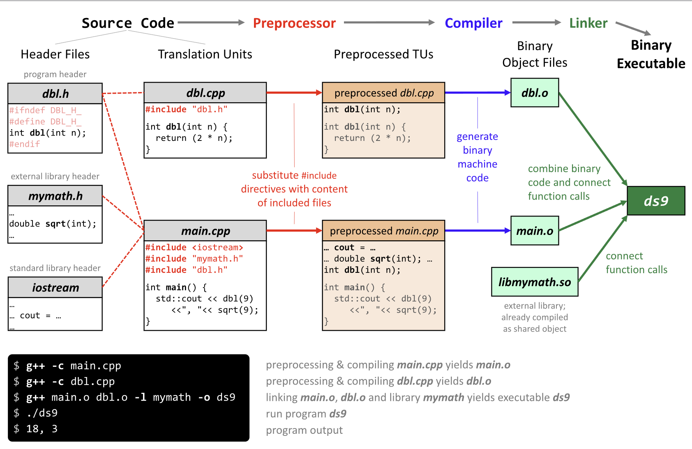
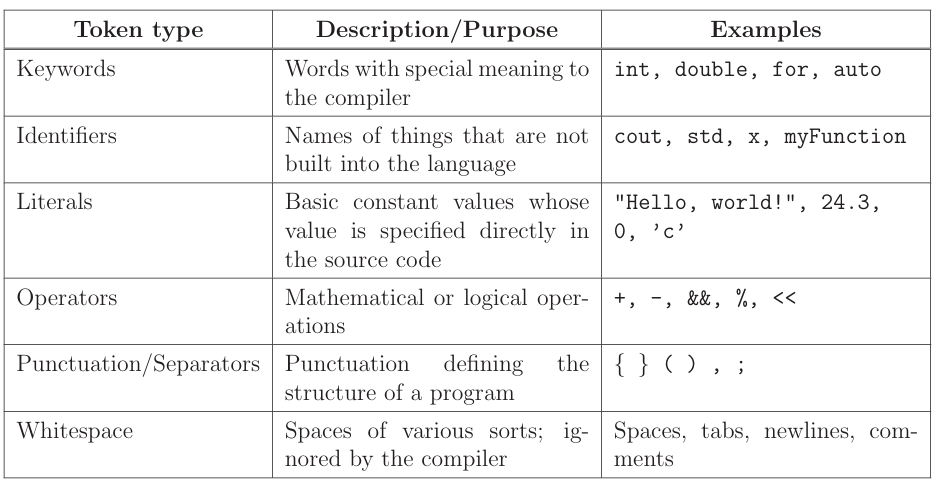
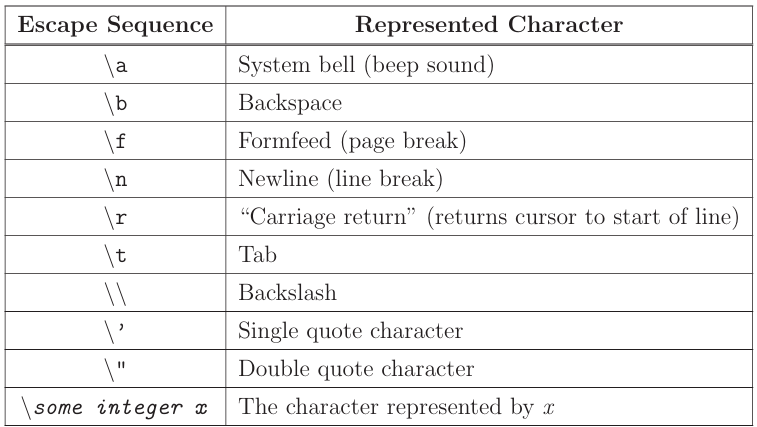

# Into to C++ 

## History
- In 1972 Ken Thompson and Dennis Ritchie created C language.
- In 1983 Bjarne Stroustrup developed C++.

# Evolution of C++
- Various version of C++ were released.
    - 1979: C with Classes
    - 1983: C++
    - 1998: C++98
    - 2003: C++03
    - 2011: C++11
    - 2014: C++14
    - 2017: C++17
    - 2020: C++20
    - 2023: C++23

# Why C++
- A processor can only understand intructions in assembly. 

- So why are we not writing assembly everyday ?
    - Needs a lot of code to do simple tasks.
    - Very hard to understand.
    - Extremly unportable.

    ```c
    // Assembly Language in C
    #include "stdio.h"
    #include "stdlib.h"

    int main(int argc, char *argv)
    {
        asm(  "sub    $0x20,%rsp\n\t"
                "movabs $0x77202c6f6c6c6548,%rax\n\t"  
                "mov    %rax,(%rsp)\n\t"
                "movl   $0x646c726f, 0x8(%rsp)\n\t"    
                "movw   $0x21, 0xc(%rsp)\n\t"          
                "movb   $0x0,0xd(%rsp)\n\t"            
                "leaq    (%rsp),%rax\n\t"              
                "mov    %rax,%rdi\n\t"
                "call  __Z6myputsPc\n\t"               
                "add    $0x20, %rsp\n\t"
            );
        return EXIT_SUCCESS;
    }
    ```
    ```c
    // C Language
    #include "stdio.h"
    #include "stdlib.h"

    int main(int argc, char *argv)
    {
        printf("%s", Hello, World!\n");
        return EXIT_SUCCESS;
    }
    ```
    ```c++
    // C++ Language
    #include <iostream>

    int main(int argc, char *argv)
    {
        std::cout << "Hello, World!" << std::endl;
        return 0;
    }
    ```

C++ offers the following advantages:
- **Conciseness**: It allows us to express common sequences of commands in a concise manner and gives us powerful shorthands.

- **Maintainibility**: Modifying code is easier when it only requires editing few lines compared to long pages of assembly code.

- **Portability**: Different processor make different instruction sets available. We can write programs as text in C++ and a compiler can convert it for nearly any processor.


# Text to Assemby (Compilation)

A program goes from Source Files (Text) --> Processor Instructions (Executable).



- **Parsing**: It is a process in which the compiler program reads the source file.

- **Object File**: Represents an incomplete copy of the whole program. Each source file expressess a piece of the program. It has markers indicating which pieces are missing.

- **Linker**: Takes the pre-compiled libraries and the object files and fills in all the gaps and creates the executable.

- **Pre-Processor**: It applied some modificaitons to the source code before being fed to the compiler.3

# Tokens
These are minimal chunk of words which have a meaning to the compiler. These are the smallest meaningful symbols in the language.



- **Keywords**: These words have a special meaning to the compiler.
    - Ex: `int`, `for`, `auto`

- **Identifiers**: These words are NOT built in to the language.
    - Ex: `cout`, `x`, `myFunc`

- **Literals**: These words are CONSTANTS which are directly specified in the source code.
    - Ex: `Hello, World!`, `88.8`, `c`

## C++ Concepts
- **Function Overloading**
    - In C++ there is no direct way to do this.
    - But we can over load a function by having multiple versions of the same function name.
        ```cpp
        // Version 1
        int half(int x, int divisor = 2)
        {
            return x / divisor;
        }

        // Version 2
        double half(double x)
        {
            return x / 2;
        }

        half(3);        // Uses: Ver#1, Returns: 2
        half(3,3);      // Uses: Ver#1, Returns: 1  
        half(3.0);      // Uses: Ver#2, Returns: 1.5
        ```


- **Statically Typed Language**
    - All variables, functions, etc are given a *type* before runtime.

        - **Runtime**: Period when the program is executing commands.
        - Example: Python is a *dynamically* typed language, variables, functions are given a type at runtime based on the things current value.

            <table>
            <tr>
            <th>Python</th>
            <th>C++</th>
            </tr>
            <tr>
            <td>
            
            ```python
            a = 4
            b = "run"
            def calc(c)
                #do something


            ```
            </td>
            <td>

            ```cpp
            int a = 4;
            std::string b = "run";
            char calc(std::string c)
            {
                //do something
            }
            ```
            </td>
            </tr>
            </table>

            <table>
            <tr>
            <th>Python</th>
            <th>C++</th>
            </tr>
            <tr>
            <td>
            
            ```python
            val = 4
            bVal = true
            str = "Hello"

            val = "Hi"; // NO error
            str = 100;  // NO error
            ```
            </td>
            <td>

            ```cpp
            int val = 4;
            bool bVal = true;
            std::string str = "Hello";

            val = "Hi"; // ERROR !!
            str = 100;  // ERROR !!
            ```
            </td>
            </tr>
            </table>

            <table>
            <tr>
            <th>Python</th>
            <th>C++</th>
            </tr>
            <tr>
            <td>
            
            ```python
            def div_3(x):
                return x / 3
            
            div_3("Hello")

            # CRASH !! during runtime


            ```
            </td>
            <td>

            ```cpp
            int div_3(int x)
            {
                return x / 3;
            }

            div_3("Hello");

            // Compile Error, code will never run
            ```
            </td>
            </tr>
            </table>

    - **`auto`**
        - Is a `keyword` in C++, used instead of a type, when declaring a **variable**. It tells the compiler to *deduce the type*.
        - This is NOT the same as NOT having a type.

            ```cpp
            auto a = "Hello";       // char* (a C string)
            auto b = 4;             // int
            auto c = 'p';           // char
            auto d = 3.14151982;    // double
            
            ```

    - **`struct`**
        - It is a group of named variabled, each with their own type, which allows programmers to *bundle different types together*.
        - Example:
            ```cpp
            struct Student
            {
                std::string name;   // These are called 
                std::string state;  // members or fields
                int age;
            };

            // Use '.' (dot) to access the field/member of the struct
            Student sam;
            sam.name = "Sam";
            sam.state = "California";
            sam.age = 18;

            // You can use Uniform Initialization as well
            Student sam{"Sam", "California", 18};

            void printStudentInfo (Student x)
            {
                std::cout << "Name:" << x.name << std::endl;
                std::cout << "State:" << x.state << std::endl;
                std::cout << "Age:" << x.age << std::endl;
            }

            // A function can also return a struct

            Student changeStudentStateToAlaska(Student x)
            {
                x.state = "Alaska";
                return x;
            }
            ```
        - Example of a `std::pair` stucture which is available in the standard template libary.
            ```cpp
            std::pair<int, string> numberWithSuffix = {1, "st"};
            // It will print `1st`.
            std::cout << numberWithSuffix.first << numberWithSuffix.second;

            // If we dont want to specify the type
            auto numberWithSuffix = std::make_pair(1, "st");
            std::cout << numberWithSuffix.first << numberWithSuffix.second;
            ```


- **Namespaces**: 
    - *Identifiers* can be defined with a **context**, which is like a directory of names, called a *namespace*.
    - When we want to tell the compiler to access a particular namespace, use the *scope resolutions operator* (`::`).
    - Ex: 
        ```c++
        std::cout << "Hello, World!";
        ```
        ```c++
        using namespace std;
        
        cout << "Hello, World!";
        ```
        ```c++
        using std::cout;     //Anywhere you write cout, compiler will assume std::cout
        
        cout << "Hello, World!";
        ```
    - Here we are saying to the compiler to look into `std` library for `cout` as it is an *Identifier*.
    - Or we can specify that for any *Identifier* look into `std` for the whole program, which eliminates the need to write `std::` everytime.

- **Escape Sequences**

    


# References
- To get into C++: https://stackoverflow.com/questions/388242/the-definitive-c-book-guide-and-list
- Online Shell: http://cpp.sh/
- Standardization: https://isocpp.org/std 