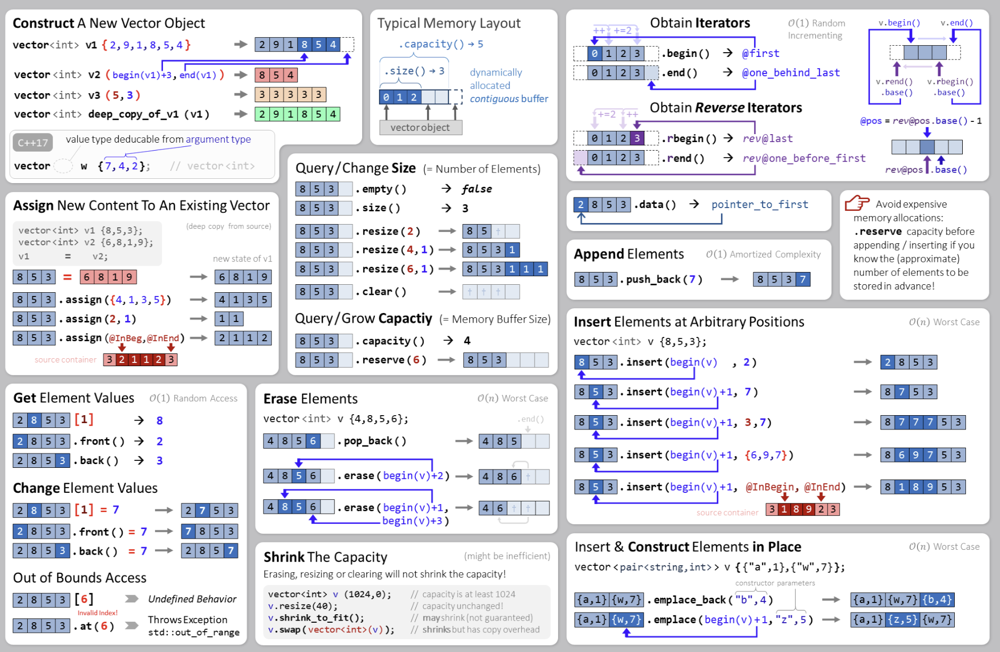
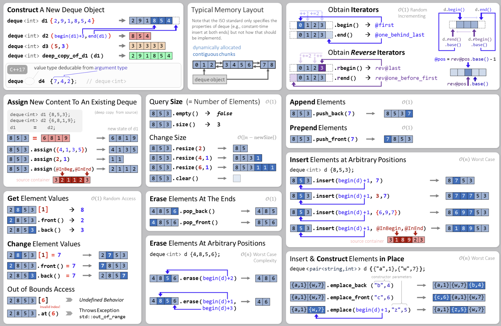

# Containers

## Invention of STL
**Alex Stepanov** invented the STL library. His thoughts on it, *As mathematicaians learned to lift theorems into their most general setting, so I wanted to lift algorithms and data structures.*


## Sequence Containers
- These provide access to `sequences` of elements.
    ```cpp
    std::vector<T>
    std::deque<T>
    std::list<T>
    std::forward_list<T>
    ```
    
    
### `std::vector<T>`
- A vector represents a sequence of elements of **any** type.
- The `type` can be specified when using the vector.
    ```cpp
    #include <vector>
    std::vector<int> v;                    // v = {}
    cout << v.size() << endl;              // outputs '0'
    v.push_back (20);                      // v = {20}
    v.push_back (10);                      // v = {20,10}
    v.push_back (99);                      // v = {20,10,99}
    cout << v[1] << endl;                  // outputs '10'
    cout << v.size() << endl;              // outputs '3'
    ```
    
- When trying an access an element in the vector, it **DOES NOT** perform a bounds check.
- If the program is written correctly, bounds checking will just slow down the code.
- Vectors can grow efficiently in **one direction**. 

### `std::deque<T>`
- It is pronounced as `deck`, abbriviates to *double ended queue*.
- It can do *everything* a vector can do.
- Also, it is possible (and fast) to `push_front` and `pop_front` unlike vector.
    


### References
`https://hackingcpp.com/cpp/std/sequence_containers.html`