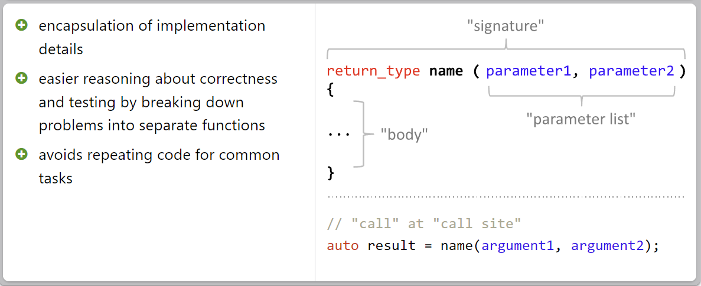
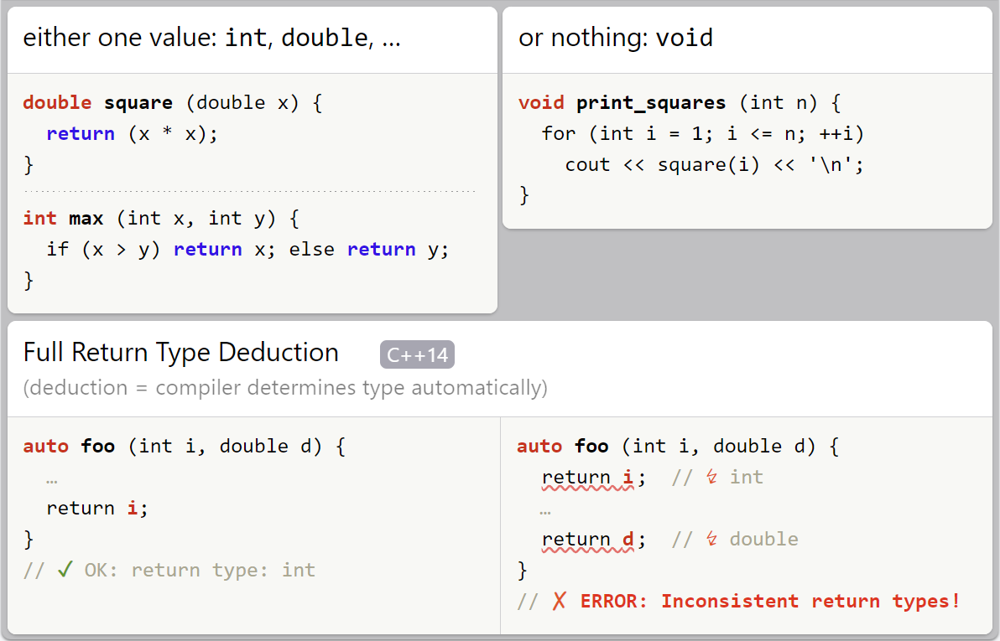
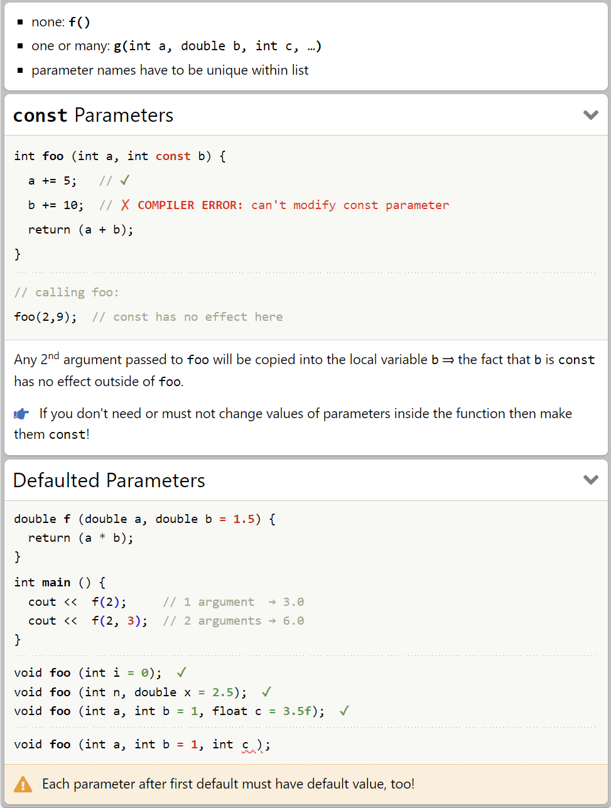
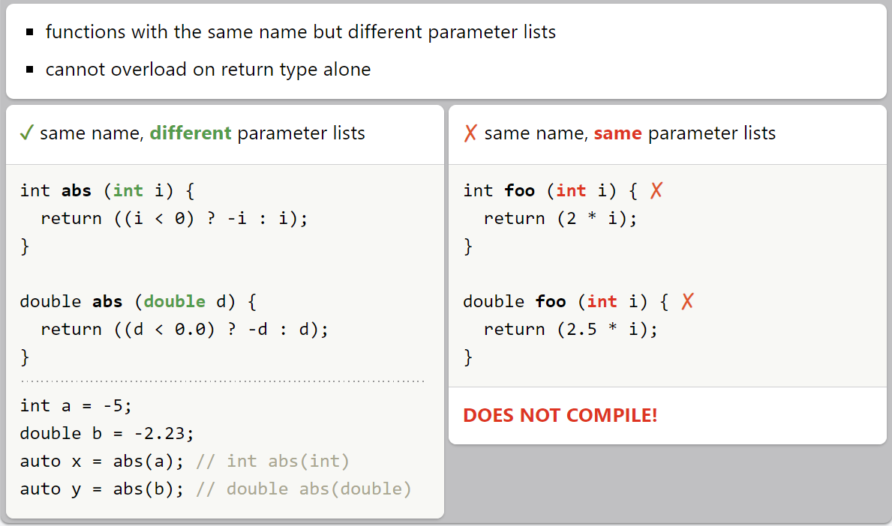
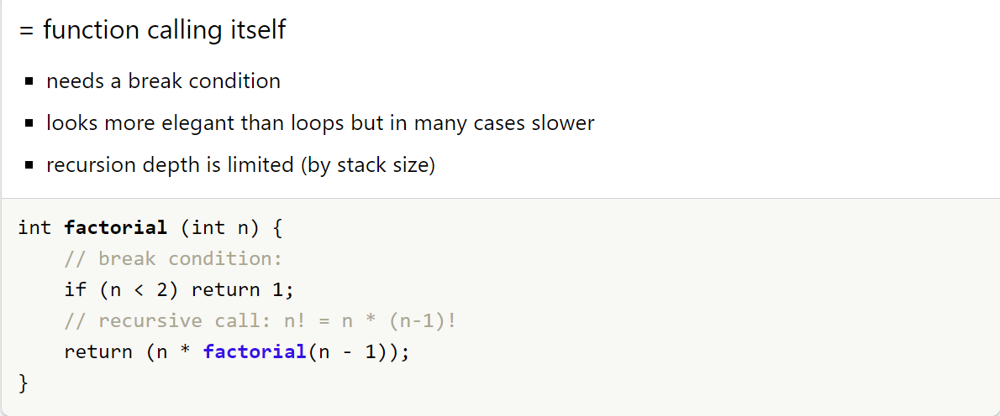
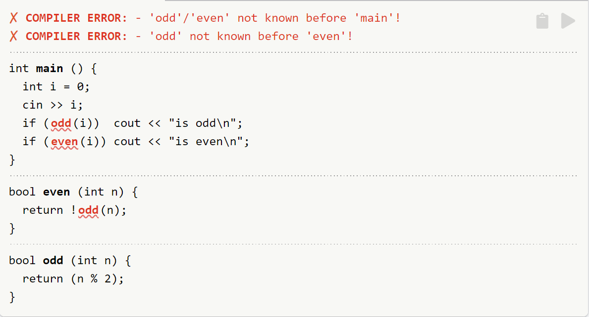
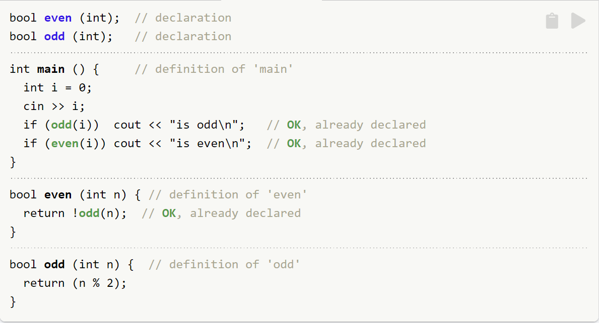
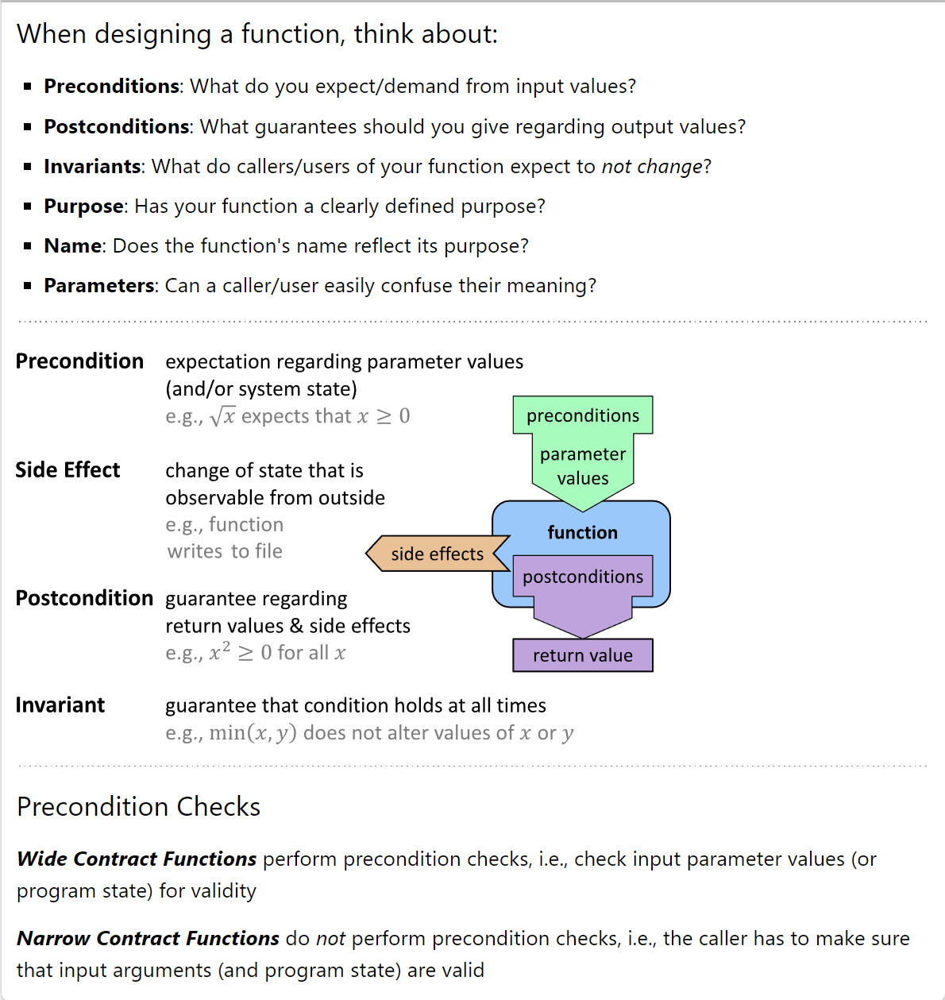
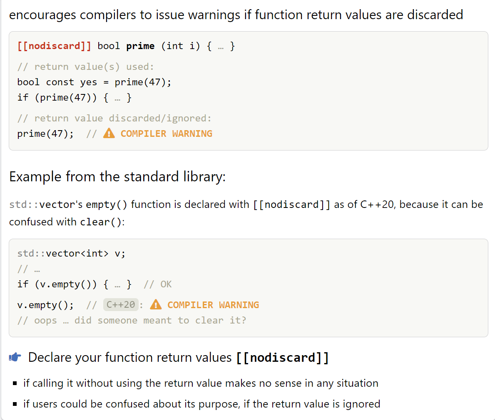

# Functions

## Overview
```cpp
#include <iostream>

double mean (double a, double b)
{
  return (a + b) / 2;
}

int main ()
{
  std::cout << mean(2, 6) <<'\n';  // prints 4
  return 0;
}
```



- ## Return Types
    

- ## Parameters/ Arguments
    


- ## Overloading
    

- ## Implementation
    - ### Recursion
        
        

    - ### Declaration vs Definition
        - Can only call functions that are already known (from before/above).
        - Only one definition allowed per source file (translation unit).
        - It is ok to have any number of declarations = announcing the existence of a function by specifying its signature.
        
        


- ## Design
    *Interfaces should be easy to use correctly and hard to use incorrectly.* -- By Scott Meyers

    


- ## Attribute
    

- ## No-Throw Guarantee
    
