# References

## Capabilities & Limitations
- ## NON `const` References
    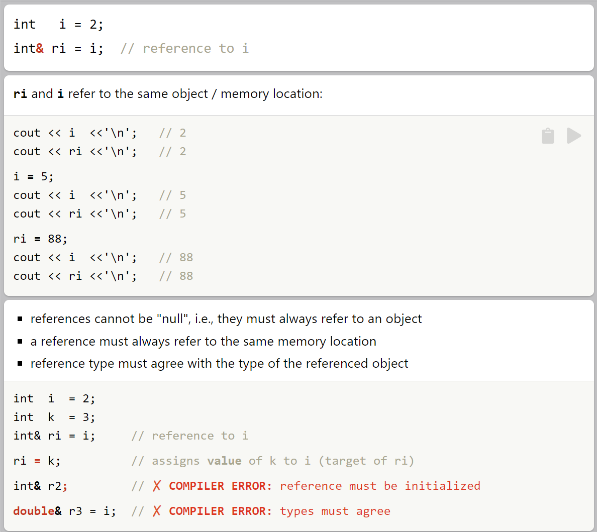

- ## `const` References
    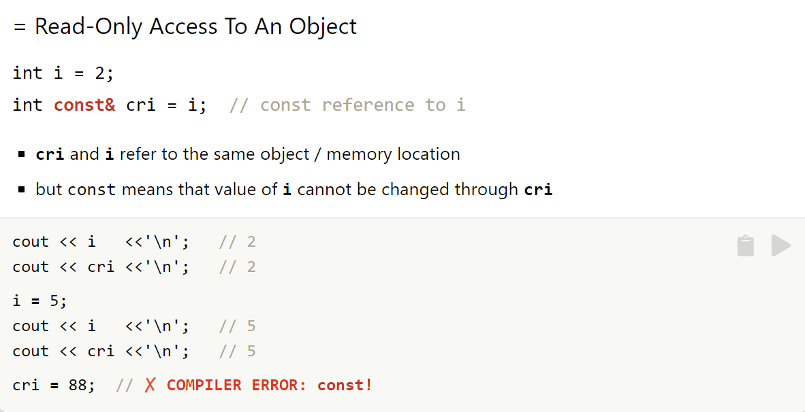

- ## `auto` References
    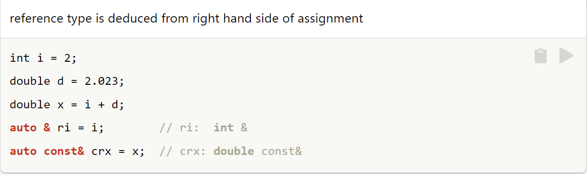

## Usage
- ## Range based in loops
    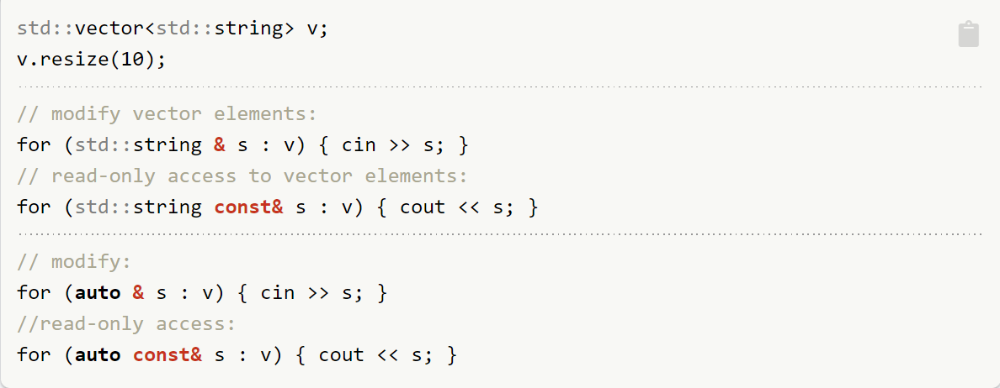

- ## `const` Reference Parameters
    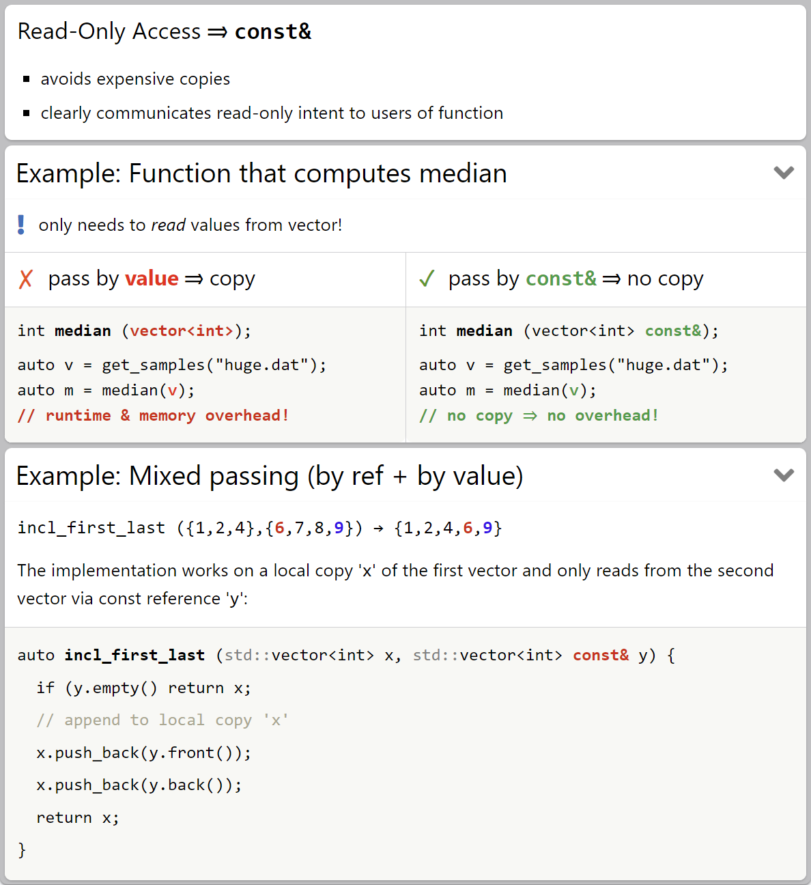

- ## NON `const` References Parmeters
    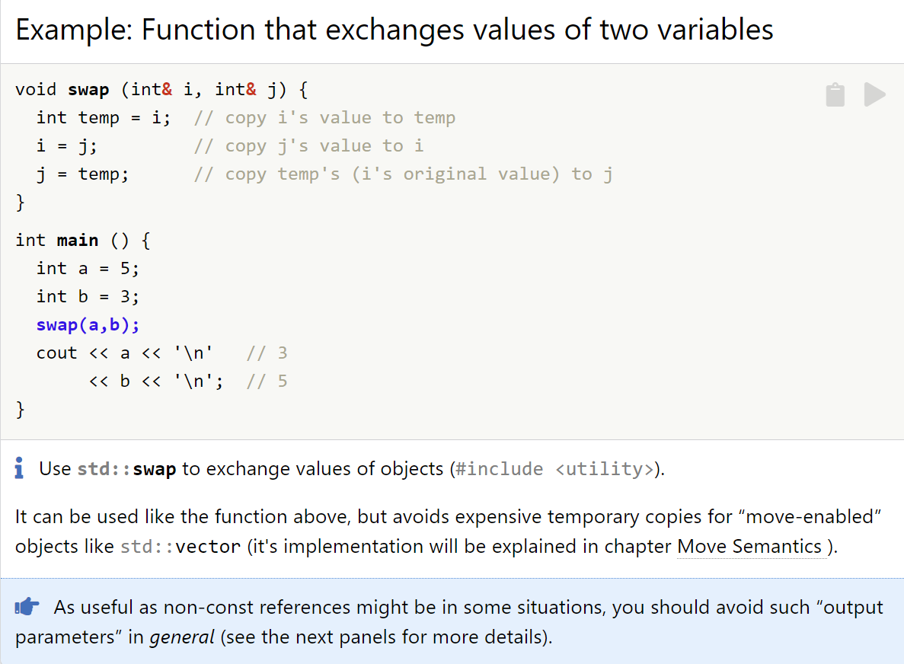## Usage
- ## Range based in loops
    

- ## `const` Reference Parameters
    

- ## NON `const` References Parmeters
    

- ## Function Parmeters
    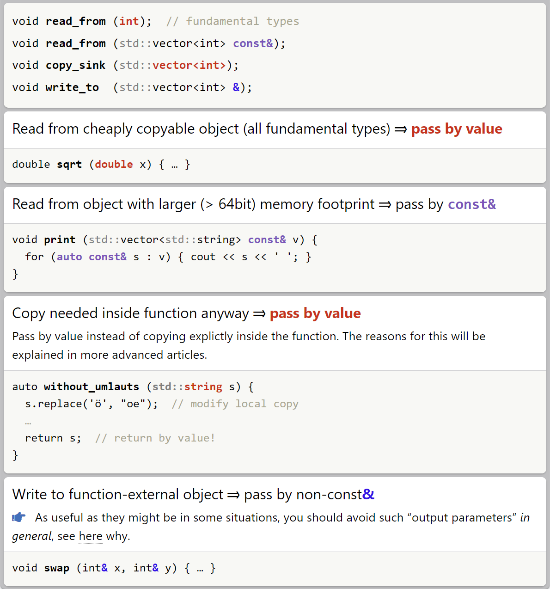

- ## Avoid Output Parmeters
    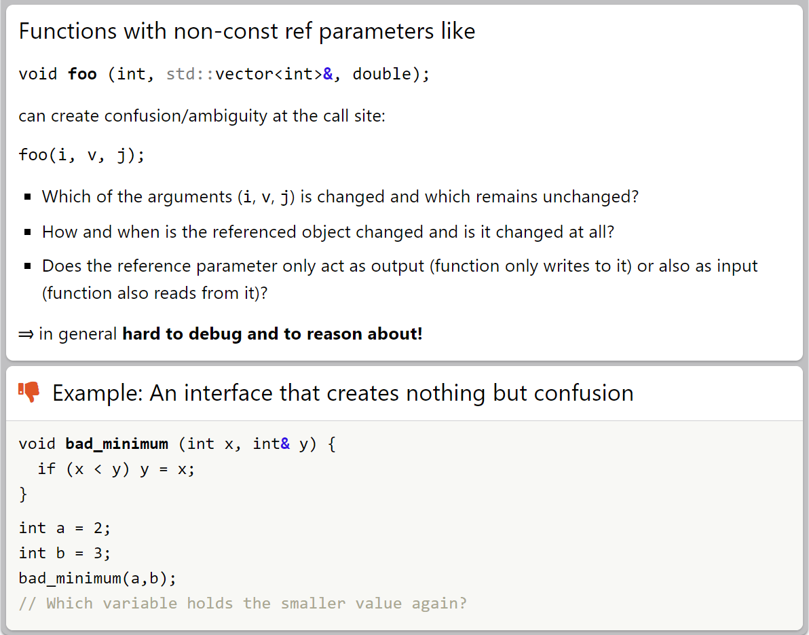

## Binding Rules
- ## R-Value VS L-Value
    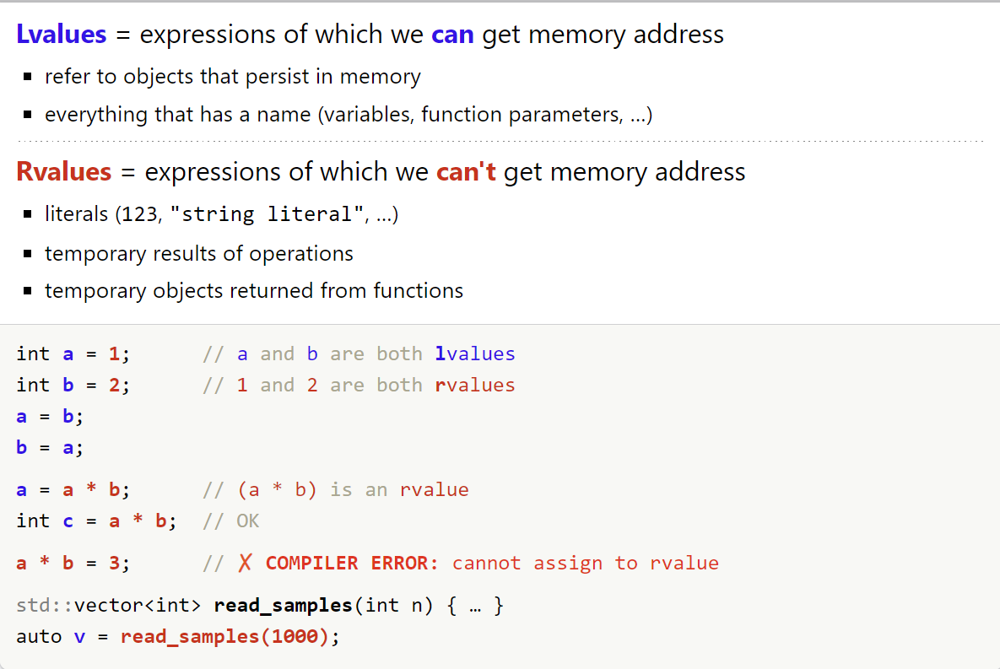

- ## Reference Binding Rules
    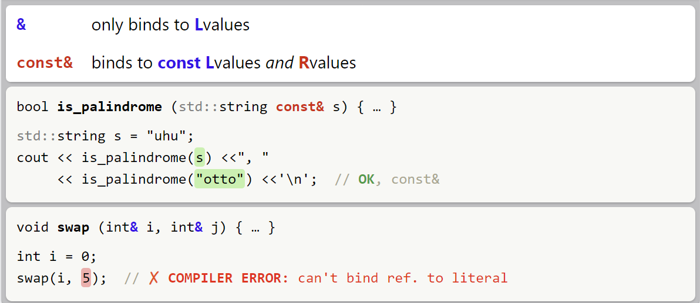

## Pitfalls
- ## Never Return a Reference to a Function-*local* Object
    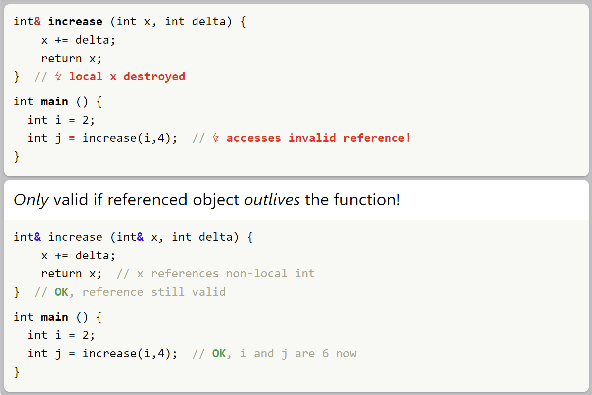

- ## Careful With Referencing `vector` elements
    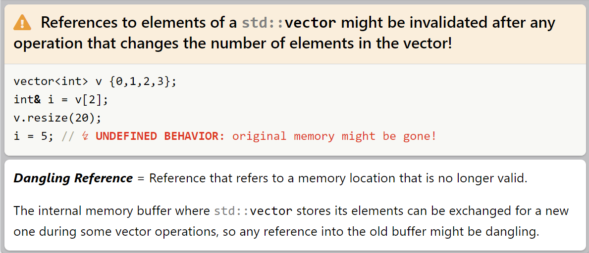

- ## Avoid Lifetime Extensions
    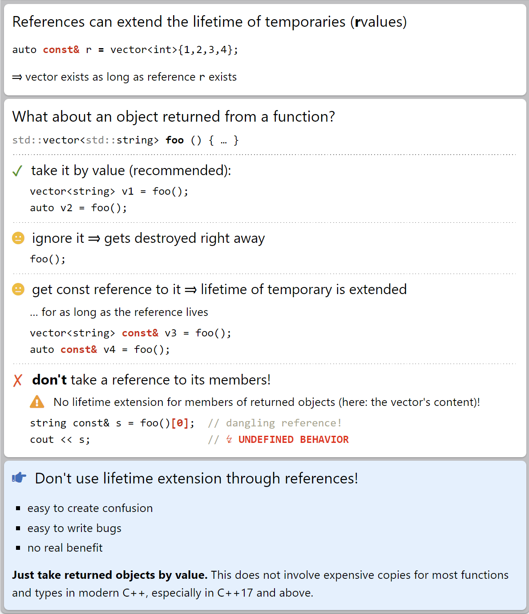

## References
`https://hackingcpp.com/cpp/lang/references.html`