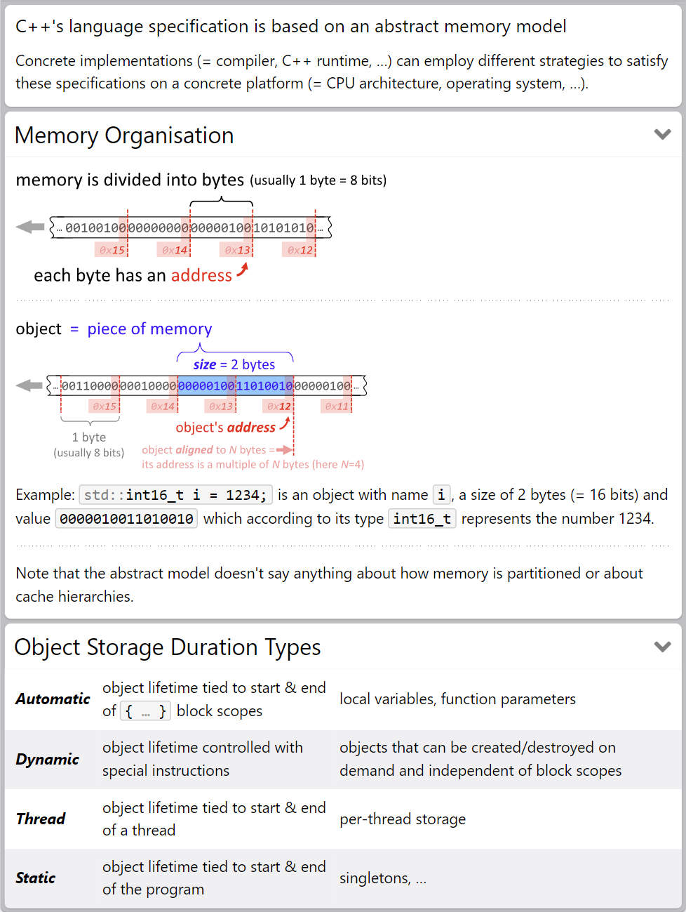
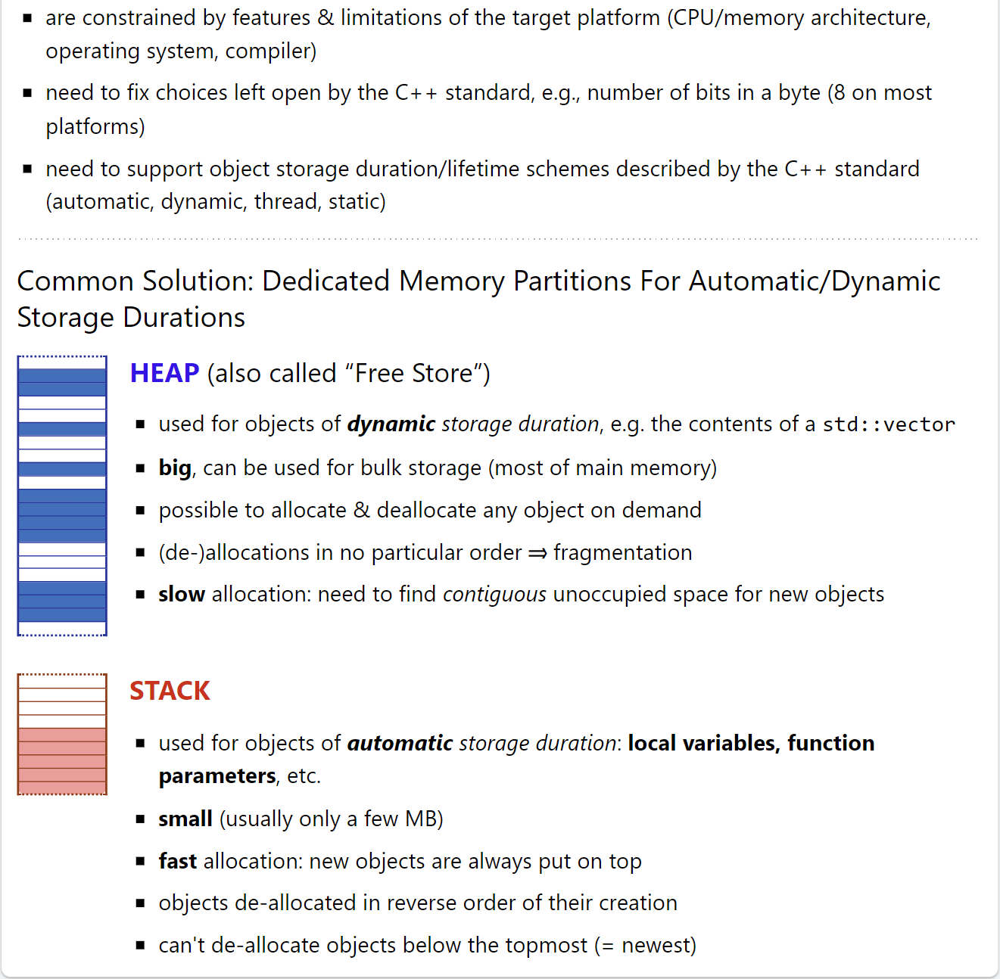
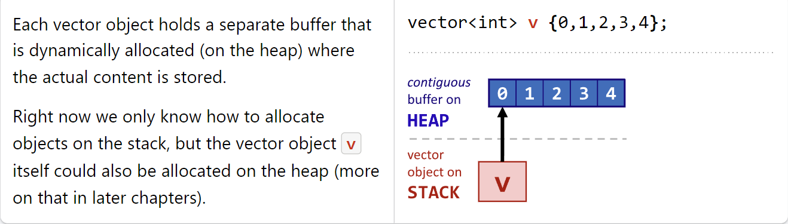
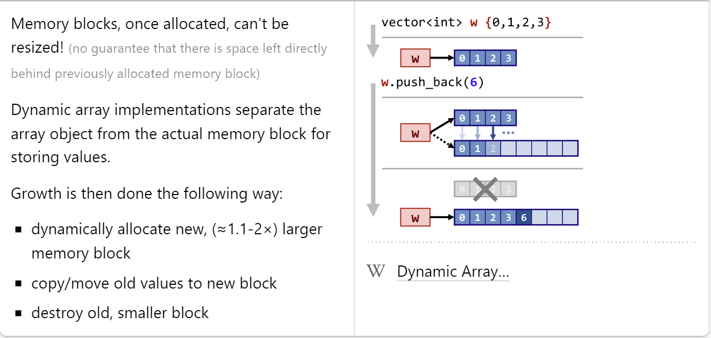
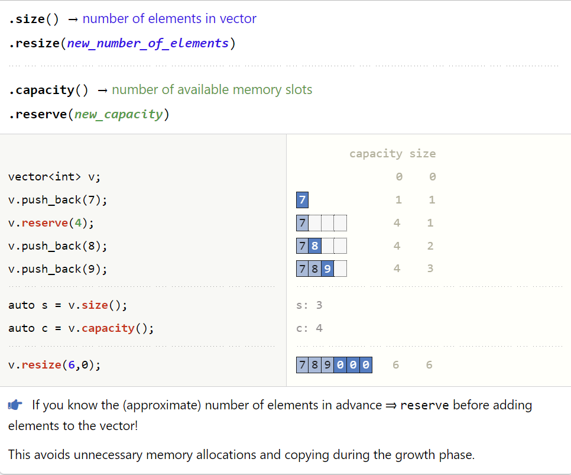

# Memory

- # Memory Model
    

- # Memory Handling
    

- # Dynamic Storage (`std::vector`)
    - Memory Layout
        
    - Growth Scheme
        
    - Size vs Capacity
        

## References
`https://hackingcpp.com/cpp/lang/memory_basics.html`