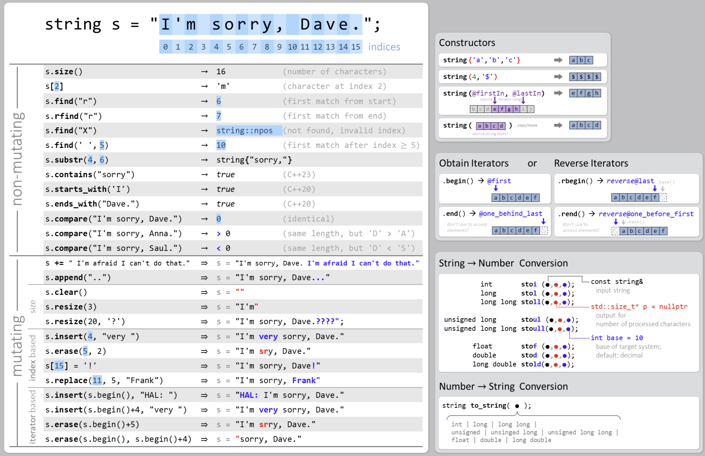
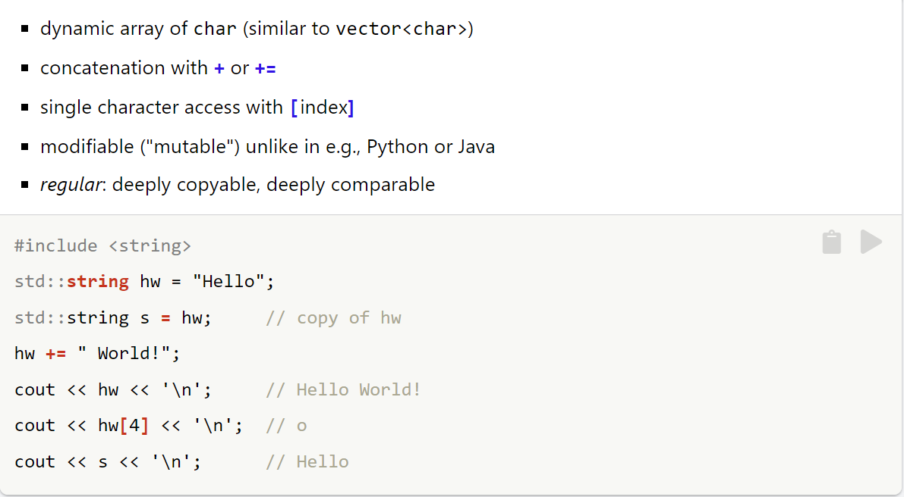
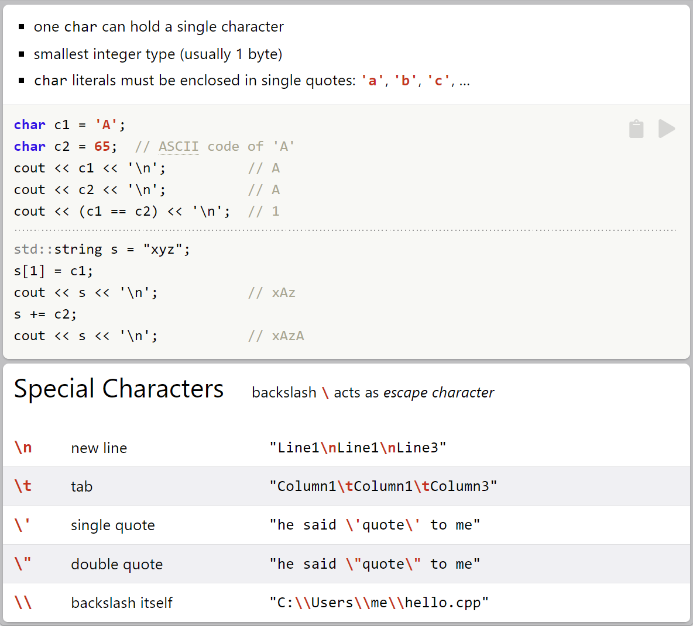
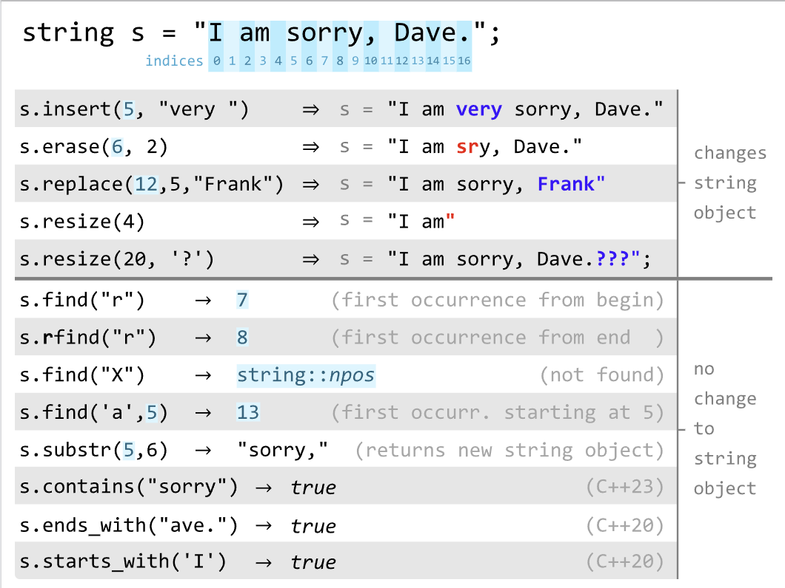
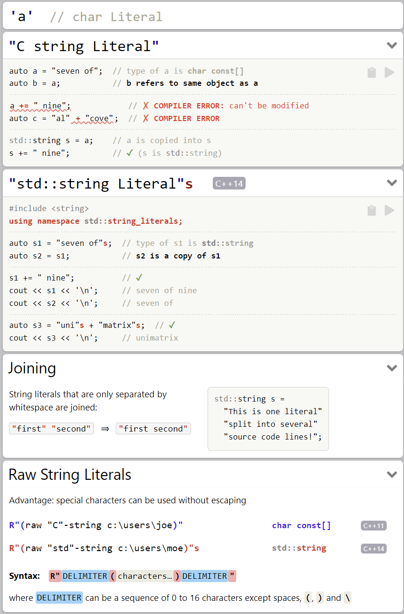
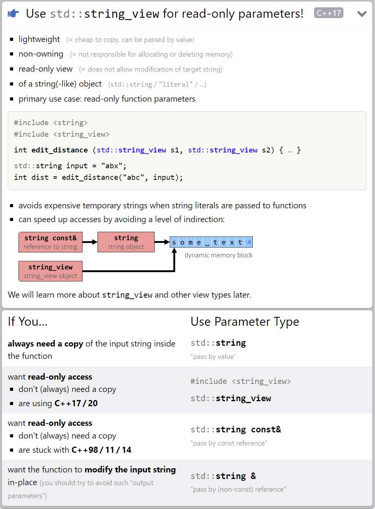
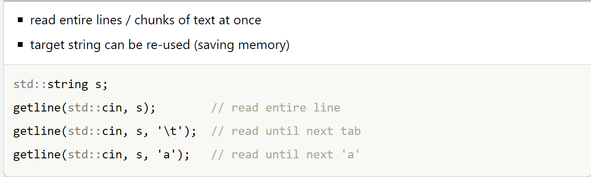

# String

- ## `std::string` Overview
    

- ## `std::string`
    

- ## `char`
    

- ## `std::string` Manipulation
    

- ## Literals
    

- ## Function Parameters
    

- ## `std::getline`
    